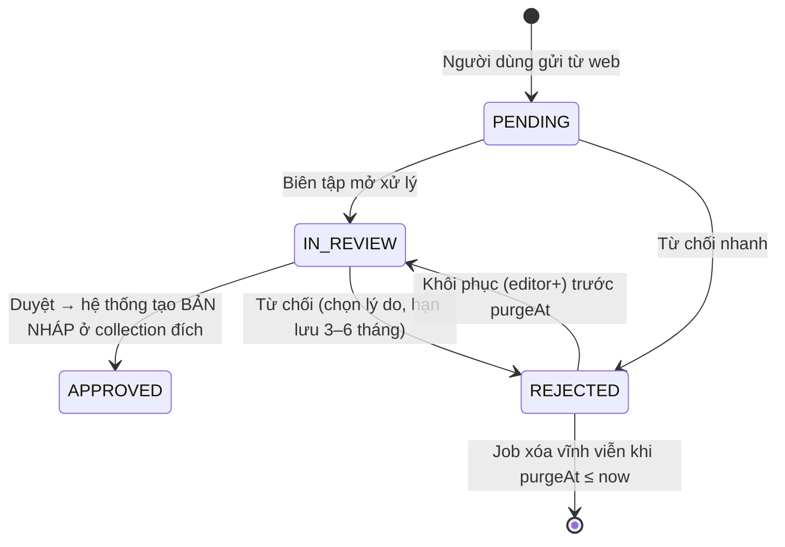

# 02 — TÀI LIỆU CMS & BACKEND (PAYLOAD 3.x + POSTGRESQL)
# DỰ ÁN: CỔNG THÔNG TIN ĐIỆN TỬ OCOP VIỆT NAM

- **Phiên bản:** 2.0 — **Dành cho:** BE (và FE khi làm tùy biến admin)
- Thay thế hoàn toàn `02-KIEN-TRUC-CMS-VA-DB.md` và `03-TAI-LIEU-API-BE.md` bản 1.0.
- Đọc cùng `AGENTS.md`. Phạm vi và lịch: `00-TONG-QUAN.md`.

---

## 1. Cấu hình lõi (`src/payload.config.ts`)

| Mục | Giá trị |
|---|---|
| Phiên bản | Payload 3.x (≥ 3.73, bản đã được ghi nhận chạy với Next 16 là 3.88). **Pin chính xác sau spike**, không dùng `^`/`latest`. Next.js `>=16.2.0`. Node 22 LTS. |
| DB | `@payloadcms/db-postgres`, `DATABASE_URI`. Dev: `push: true`. **Staging/Prod: `push: false` + migration**. |
| Editor | `@payloadcms/richtext-lexical` (xem 5.3) |
| Localization | `locales: ['vi','en'], defaultLocale: 'vi', fallback: true`. Mọi trường chữ hiển thị công khai đặt `localized: true`. Giao diện Phase 1 chỉ dùng `vi`. |
| Admin | `admin.user = 'users'`, `admin.meta.titleSuffix = ' — OCOP CMS'`, ngôn ngữ giao diện admin `vi` (cấu hình `i18n` + gói dịch; thiếu chuỗi thì để tiếng Anh, không tự dịch hàng loạt) |
| Bảo mật | `csrf: [SITE_URL]`; cookie `secure`, `sameSite: 'Lax'`; `cors: [SITE_URL]`; `graphQL.disable = true` (không dùng GraphQL) |
| Jobs | `jobs.tasks` + chạy bằng container `jobs` (`payload jobs:run --cron "*/1 * * * *"`); **không bật `autoRun` trong tiến trình web** để tránh chạy trùng |
| Upload | Xem `media` và `submission-files` ở mục 4 |
| Kiểu | `typescript.outputFile = 'src/payload-types.ts'` |

Biến môi trường BE: `DATABASE_URI`, `PAYLOAD_SECRET` (≥ 32 ký tự), `SITE_URL`, `MEDIA_DIR=/data/media`, `PRIVATE_UPLOAD_DIR=/data/private`, `TURNSTILE_SECRET_KEY`, `CRON_SECRET`, `PREVIEW_SECRET`.

---

## 2. Quy ước chung cho collection nội dung công khai

Áp dụng cho: `articles`, `events`, `legal-documents`, `products`, `producers`, `destinations`.

**Trường chung (khai báo bằng một hàm `commonContentFields()` dùng lại):**

| Trường | Kiểu | Ghi chú |
|---|---|---|
| `title` | text, `localized`, required | Dùng làm `useAsTitle` |
| `slug` | text, unique, index | Tự sinh từ `title` (bỏ dấu, `đ→d`, chữ thường, `-`); sửa được; xem hook slug (mục 6) |
| `_status` | draft/published (Payload tự có) | `versions.drafts` |
| `publishedAt` | date | Tự đặt khi publish lần đầu; sửa được để đăng bù |
| `coverImage` | relationship → `media` | Bắt buộc khi publish (trừ `legal-documents`) |
| `excerpt` | textarea, `localized`, max 300 | Mô tả ngắn cho thẻ + meta description |
| `province` | relationship → `provinces` | Lọc theo tỉnh |
| `isFeatured` | checkbox | Tiêu điểm |
| `isArchived` | checkbox | Thay cho xóa (xem quy tắc 10 năm) |
| `seo` | group: `title`, `description`, `ogImage` | Để trống thì FE dùng `title`/`excerpt`/`coverImage` |
| `sourceSubmission` | relationship → `submissions`, read-only | Nguồn gốc nếu tạo từ bài gửi |

**Cấu hình chung:**
```ts
versions: { drafts: { autosave: { interval: 2000 }, schedulePublish: true }, maxPerDoc: 50 },
access: contentAccess,            // mục 3
hooks: {
  beforeValidate: [ensureSlug],
  beforeChange:   [setPublishedAt],
  afterChange:    [revalidateOnChange, syncSearchIndex, writeAudit],
},
```
`afterDelete` **không dùng** (không ai xóa được).

---

## 3. Phân quyền

### 3.1 Vai trò (field `role` của `users`, select, required)

| Vai trò | Giá trị | Quyền |
|---|---|---|
| Quản trị | `admin` | Toàn quyền cấu hình, quản lý tài khoản, xem audit log, chỉnh `landing-pages`/`site-settings`/`home`. **Vẫn không xóa được nội dung công khai.** |
| Biên tập | `editor` | Tạo/sửa mọi nội dung, **Publish/Unpublish**, duyệt/từ chối `submissions`, chỉnh `home` và `landing-pages` |
| Cộng tác viên | `contributor` | Tạo bản ghi **nháp**; chỉ sửa bản ghi do mình tạo khi đang nháp; **không Publish**; không thấy `submissions` |

Người dùng nội bộ chỉ có 3 vai trò này. Tài khoản đăng nhập **chỉ** do `admin` tạo (`users.access.create = isAdmin`), không có đăng ký công khai.

### 3.2 Helper (`src/access/`)
```ts
isAdmin            // ({ req }) => req.user?.role === 'admin'
isEditorOrAbove    // role in ['admin','editor']
isStaff            // có user đăng nhập
isOwnDraft         // contributor: { createdBy: { equals: req.user.id }, _status: { equals: 'draft' } }
publicReadPublished // anonymous: { _status: { equals: 'published' }, isArchived: { not_equals: true } } ; staff: true
```

### 3.3 Ma trận cho collection nội dung công khai (`contentAccess`)

| Thao tác | Ẩn danh | contributor | editor | admin |
|---|---|---|---|---|
| `read` | chỉ `published` & chưa archive | tất cả của mình + published | tất cả | tất cả |
| `create` | ✗ | ✓ (ép `_status = draft`) | ✓ | ✓ |
| `update` | ✗ | chỉ bản nháp do mình tạo | ✓ | ✓ |
| `delete` | ✗ | ✗ | ✗ | ✗ |
| Publish (`_status = 'published'`) | ✗ | ✗ | ✓ | ✓ |

**Chặn Publish của contributor:** thêm `beforeChange` kiểm tra: nếu `req.user.role === 'contributor'` và `data._status === 'published'` → ném `APIError(403, 'Bạn không có quyền xuất bản')`. Phải test cả qua admin lẫn REST (spike S4).

`createdBy`: field `relationship → users`, `admin.readOnly`, gán trong `beforeChange` khi tạo (`req.user.id`).

### 3.4 Quyền theo collection còn lại

| Collection | read | create | update | delete |
|---|---|---|---|---|
| `users` | admin; mỗi người đọc chính mình | admin | admin; tự đổi mật khẩu của mình | ✗ (khóa tài khoản bằng `isActive=false`) |
| `media` | công khai (file); metadata: staff | staff | editor+ | ✗ |
| `provinces`, `tags` | công khai | admin (tags: editor+) | admin (tags: editor+) | ✗ |
| `landing-pages` | công khai (published) | admin | editor+ | ✗ |
| `redirects` | công khai (FE đọc server-side) | hệ thống + admin | admin | admin |
| `submissions` | editor+ | **✗ (chỉ endpoint, `overrideAccess`)** | editor+ | ✗ (job dọn dùng `overrideAccess`) |
| `submission-files` | editor+ (qua endpoint tải có kiểm quyền) | ✗ (chỉ endpoint) | ✗ | ✗ (job) |
| `audit-logs` | admin | ✗ (chỉ hook) | ✗ | ✗ |
| `search-index` | công khai qua endpoint; REST trực tiếp: ✗ | ✗ (hook) | ✗ | ✗ |

### 3.5 Mật khẩu & đăng nhập
- Dùng cơ chế băm mật khẩu **có sẵn của Payload**; không tự viết.
- `auth: { maxLoginAttempts: 5, lockTime: 15 * 60 * 1000, tokenExpiration: 7200, cookies: {...} }`.
- Chính sách mật khẩu: validate ≥ 12 ký tự (hàm `validate` trên field `password` hoặc hook `beforeValidate` của `users`).
- 2FA: Phase 2. Phase 1 bù bằng IP allowlist/VPN ở Nginx (`03` mục 4).

---

## 4. Collections (Phase 1)

> Nhóm admin (`admin.group`): **Nội dung** (articles, events, legal-documents, products, producers, destinations), **Trang** (landing-pages, globals), **Thư viện** (media, tags), **Tiếp nhận** (submissions), **Hệ thống** (users, provinces, redirects, audit-logs, search-index).

### 4.1 `users` (auth)
`name` (text, required), `role` (select 3 giá trị, required, mặc định `contributor`), `isActive` (checkbox, mặc định true; `false` → chặn đăng nhập qua `auth.strategies`/hook `beforeLogin`).

### 4.2 `media` (upload)
- `upload: { staticDir: process.env.MEDIA_DIR, mimeTypes: ['image/jpeg','image/png','image/webp','application/pdf'], imageSizes: [{ name: 'adminThumb', width: 400 }], adminThumbnail: 'adminThumb' }`. **Không** sinh nhiều kích cỡ cho web: ảnh web đi qua imgproxy.
- Giới hạn dung lượng 20 MB (`upload.limits.fileSize`; Nginx `client_max_body_size 25m` cho đường dẫn upload).
- Trường: `alt` (text, localized, **required khi file là ảnh**), `caption` (text, localized), `credit` (text: nguồn/tác giả ảnh), `kind` (select `IMAGE|DOCUMENT`, tự đặt theo mime).
- Hook `beforeOperation`: đổi tên file thành `yyyy/mm/<uuid>.<ext>` (chống trùng, chống tên lạ). Nếu Payload không cho thư mục con trong `filename` ở bản đã pin thì dùng `<uuid>.<ext>`.
- Kiểm tra **magic bytes** (gói `file-type`) trong hook: mime khai báo phải khớp nội dung.
- `delete: false`.

### 4.3 `submission-files` (upload, riêng tư)
- `staticDir: PRIVATE_UPLOAD_DIR` (**ngoài** thư mục Nginx phục vụ công khai); `mimeTypes`: jpeg, png, webp, pdf, docx; 20 MB.
- Chỉ tạo qua endpoint gửi bài (mục 7). Trường `submission` (relationship), `originalName`, `sizeBytes`, `sha256`.
- Tải về cho biên tập viên: endpoint `GET /api/submission-files/:id/download` (kiểm `editor+`, đặt `Content-Disposition: attachment`, `X-Content-Type-Options: nosniff`). Không có URL tĩnh công khai.

### 4.4 `provinces`
`name` (localized, required), `slug` (unique), `code` (unique, mã hành chính), `region` (select `BAC|TRUNG|NAM`), `sortOrder` (number). **Đúng 34 bản ghi** nạp bằng `seed/provinces.json` lấy từ **nguồn chính thức của cơ quan nhà nước** (Techlead cung cấp/duyệt; không tự gõ từ trí nhớ). Phase 2 thêm bảng ánh xạ 63→34 và thống kê cho bản đồ.

### 4.5 `tags`
`name` (localized, required), `slug` (unique). (Bản 1.0 thiếu bảng nối bài–tag; ở đây `articles.tags` là relationship `hasMany`.)

### 4.6 `articles` — gộp Tin tức, Câu chuyện, OCOP Hội nhập
Thêm vào trường chung:

| Trường | Kiểu | Ghi chú |
|---|---|---|
| `kind` | select `NEWS\|STORY\|INTEGRATION`, required | Quyết định URL (`lib/paths.ts`) |
| `topic` | select, required | Giá trị hợp lệ theo `kind` (bảng dưới); validate trong hook |
| `marketCode` | select `EU\|US\|JAPAN\|CHINA\|HALAL`, hiện khi `topic = EXPORT_MARKET` | `admin.condition` |
| `content` | richText Lexical, `localized`, required khi publish | mục 5.3 |
| `videoUrl` | text (URL YouTube/Vimeo), tùy chọn | Chỉ nhúng, kiểm tra domain cho phép |
| `authorName` | text | Tên tác giả hiển thị |
| `sourceName` | text | Nguồn tin (nếu có) |
| `tags` | relationship → `tags`, `hasMany` | |
| `relatedProducts` | relationship → `products`, `hasMany`, tối đa 4 | Hiển thị cuối bài Câu chuyện |
| `readingMinutes` | number, read-only | Tính trong `beforeChange` (≈ 200 từ/phút) |
| `isBreaking` | checkbox | Tin nóng/banner |

| `kind` | `topic` hợp lệ | URL |
|---|---|---|
| `NEWS` | `GENERAL`, `POLICY`, `TRADE_PROMOTION`, `LOCAL_OCOP` | `/tin-tuc-su-kien/tin-tuc/[slug]` |
| `STORY` | `CULTURE`, `JOURNEY`, `REPORTAGE` | `/cau-chuyen-ocop/[slug]` |
| `INTEGRATION` | `OVERVIEW`, `EXPORT_MARKET`, `STANDARDS`, `DIGITAL` | `/ocop-hoi-nhap/[slug]` |

Chỉ mục DB: `(kind, topic, _status, publishedAt DESC)`, `(province)`.

### 4.7 `events`
Trường chung (không cần `coverImage` bắt buộc ngoài publish) + `startAt` (date, required), `endAt` (date, required, ≥ `startAt`), `locationName` (text), `locationAddress` (text), `registrationUrl` (text, URL), `isInternational` (checkbox), `agenda` (array: `time` text, `title` text localized, `description` textarea localized), `content` (richText), `category` (select `TRADE_FAIR|FORUM|TRAINING|FESTIVAL|OTHER`).
**Trạng thái sự kiện (`upcoming|ongoing|ended`) KHÔNG lưu**; tính khi truy vấn từ `startAt/endAt` so với thời điểm hiện tại (khắc phục lệch `status` ở bản 1.0).
Chỉ mục: `(startAt, endAt)`.

### 4.8 `legal-documents`
Trường chung (không cần `coverImage`, `excerpt` dùng làm trích yếu) + `documentNumber` (text, unique, required), `level` (select `CENTRAL|PROVINCIAL|MINISTERIAL`), `docType` (select `LUAT|NGHI_DINH|THONG_TU|QUYET_DINH|KE_HOACH|KHAC`), `issuedDate` (date, required), `effectiveDate` (date), `file` (relationship → `media`, PDF), `issuer` (text).
`slug` sinh từ `documentNumber`.

### 4.9 `producers` (Chủ thể OCOP)
Trường chung + `producerCode` (text, unique), `entityType` (select `COOPERATIVE|ENTERPRISE|HOUSEHOLD`, required), `logo` (→ media), `establishedYear` (number), `contact` (group: `phone`, `email`, `website`, `address`), `latitude`/`longitude` (number, tùy chọn), `description` (richText, localized), `products` (**join field** sang `products.producer`, read-only).
`province` bắt buộc khi publish.

### 4.10 `products`
Trường chung + `productCode` (text, unique), `category` (select `NONG_SAN_THUC_PHAM|DUOC_LIEU_SUC_KHOE|THU_CONG_MY_NGHE`, required), `producer` (→ `producers`, required khi publish), `stars` (select `3|4|5`, lưu number, required), `certificationYear` (number), `images` (array → media, tối đa 8; ảnh đầu là ảnh chính; thay `coverImage` bắt buộc), `description` (richText), `specs` (array: `label`, `value`, localized), `ctaType` (select `origin|contact`), `isNationalTreasure` (checkbox).
Hook: nếu `province` trống → lấy từ `producer.province`.
Chỉ mục: `(category, stars, province, _status)`.

### 4.11 `destinations` — gộp Điểm đến, Làng nghề, Du lịch sinh thái
Trường chung + `kind` (select `DESTINATION|CRAFT_VILLAGE|ECO_TOUR`, required), `gallery` (array → media), `latitude`/`longitude`, `content` (richText), và trường theo loại (`admin.condition`):
- `CRAFT_VILLAGE`: `craftGroup` (select theo nhóm nghề — danh sách do Content chốt, mặc định `GOM_SU|DET_MAY|MAY_TRE_DAN|DIEU_KHAC|KIM_HOAN|KHAC`), `ageYears`, `artisanCount`, `isNationalHeritage`.
- `ECO_TOUR`: `ecosystem` (select `HIGHLAND_TEA_COFFEE|RIVER_GARDEN_DELTA|MEDICINAL_FOREST|COASTAL_ISLAND`), `durationDays`, `isFeaturedRoute`, `itinerary` (array: `day`, `title`, `description`).
URL chung `/diem-den-du-lich/[slug]`.

### 4.12 `landing-pages` (thay `pages` + `page_sections` của bản 1.0 cho các trang không phải trang chủ)
Mỗi bản ghi = một trang danh sách/giới thiệu. **Không có page builder.** Bản ghi tạo sẵn bằng seed; Content chỉ sửa nội dung.

| Trường | Kiểu |
|---|---|
| `key` | select, unique, read-only sau khi tạo |
| `heading` (thẻ `<h1>`) | text, localized, required |
| `intro` | textarea, localized |
| `heroImage` | → media |
| `pinned` | relationship **đa hình** → `articles`/`products`/`destinations`/`events`, `hasMany`, tối đa 6 (mục ghim) |
| `body` | richText, localized (tùy chọn, ví dụ hướng dẫn gửi bài) |
| `seo` | group |

`key` hợp lệ: `news-landing`, `news-policy`, `news-trade`, `news-local`, `integration-overview`, `integration-export`, `integration-standards`, `integration-digital`, `products-landing`, `products-agri`, `products-herbal`, `products-craft`, `products-stars`, `producers-landing`, `stories-landing`, `stories-culture`, `stories-multimedia`, `stories-journey`, `destinations-landing`, `destinations-eco`, `destinations-craft`, `submission-page`.

### 4.13 `redirects`
`from` (text, unique, bắt đầu bằng `/`), `to` (text), `type` (select `301|302`, mặc định 301), `createdBy`. Tạo tự động bởi hook slug (mục 6).

### 4.14 `audit-logs`
`actor` (→ users), `action` (select `CREATE|UPDATE|PUBLISH|UNPUBLISH|APPROVE|REJECT|DOWNLOAD_ATTACHMENT|LOGIN|PURGE`), `collection` (text), `docId` (text), `summary` (text ≤ 300), `ip` (text), `createdAt`. Không chứa nội dung bài, không chứa dữ liệu cá nhân người gửi. Chỉ ghi bằng hook; không sửa/xóa.

### 4.15 `search-index`
Xem mục 8.

### 4.16 `submissions` — xem mục 7.

---

## 5. Globals, blocks, trình soạn thảo

### 5.1 Global `site-settings`
`siteName`, `tagline`, `hotline`, `contactEmail`, `address`, `socialLinks` (array: `platform`, `url`), `editorialContact` (group: `name`, `email`, `phone`, `hours`, tất cả localized nếu là chữ), `announcement` (group: `enabled`, `text` localized, `link`), `defaultOgImage` (→ media), `footerNote` (localized). Quyền sửa: `editor+`.

### 5.2 Global `home` (page builder **chỉ cho trang chủ**)
- Trường: `layout` (field `blocks`), `seo`.
- Blocks (mỗi block có `blockType` khớp tên bên FE):

| `blockType` | Trường chính |
|---|---|
| `hero` | `eyebrow`, `heading`, `subheading` (localized), `image` (→ media), `primaryCta` {`label`,`href`}, `secondaryCta` |
| `quickLinks` | `items[]`: `icon` (select tên icon cho phép), `label`, `description`, `href` |
| `kpiStats` | `items[]`: `value` (text), `label`, `note` — nhập tay (Phase 1) |
| `featuredNews` | `heading`, `mode` (`auto`\|`pinned`), `pinned[]` → articles (NEWS, tối đa 6), `limit` |
| `featuredProducts` | như trên → products |
| `featuredStories` | như trên → articles (STORY) |
| `featuredDestinations` | như trên → destinations |
| `integrationPillars` | `items[]`: `title`, `description`, `href`, `image` |
| `ctaBanner` | `heading`, `text`, `cta` {`label`,`href`}, `image` |
| `richText` | `content` (Lexical) |

- Mỗi block `href` phải là đường dẫn nội bộ (`/...`) hoặc `https://`; validate bằng hàm dùng chung.
- Các block `featured*` ở chế độ `auto` lấy bản mới/tiêu điểm nhất theo `isFeatured`, rồi `publishedAt`.
- Global có `versions.drafts` để có nháp + lịch sử.
- **Fallback khi S2 thất bại:** thay `layout` bằng các nhóm trường cố định (`hero`, `quickLinks`, … theo thứ tự cố định); Content không đổi được thứ tự khối nhưng vẫn sửa được toàn bộ nội dung.

### 5.3 Trình soạn thảo (Lexical) cho `content`
Bật: đoạn, `h2`–`h4`, đậm, nghiêng, gạch chân, danh sách, trích dẫn, liên kết (chỉ `https://`, `mailto:`, đường dẫn nội bộ), căn lề tối thiểu.
Block nhúng trong bài (`src/blocks/richtext/`):
- `image`: `media` (→ media, bắt buộc), `caption` (text), `credit` (text, mặc định lấy từ `media.credit`), `size` (`inline|wide`).
- `gallery`: `images[]` (→ media), `caption`.
- `pullQuote`: `quote`, `attribution`.
- `embedVideo`: `url` (chỉ cho phép host YouTube/Vimeo — validate), `caption`.
Tắt: bảng phức tạp, HTML thô, nhúng iframe tự do.

---

## 6. Hooks (src/hooks/)

| Hook | Chạy ở | Hành vi |
|---|---|---|
| `ensureSlug` | `beforeValidate` | Nếu `slug` trống → sinh từ `title` bằng `lib/normalize.ts#slugify`; nếu trùng → thêm hậu tố `-2`, `-3`. |
| `slugRedirect` | `afterChange` | Nếu bản **đã xuất bản** đổi `slug` → tạo/cập nhật `redirects` (`from = đường dẫn cũ`, `to = đường dẫn mới` qua `getDocPath`). Nếu redirect chuỗi → trỏ thẳng về đích cuối. |
| `setPublishedAt` | `beforeChange` | Khi chuyển sang `published` lần đầu và `publishedAt` trống → `now`. |
| `computeReadingTime` | `beforeChange` (articles) | Đếm từ trong `content` (duyệt cây Lexical) → `readingMinutes` ≥ 1. |
| `validateKindTopic` | `beforeValidate` (articles) | `topic` phải thuộc `kind`, ngược lại ném lỗi tiếng Việt. |
| `blockContributorPublish` | `beforeChange` | Mục 3.3. |
| `setCreatedBy` | `beforeChange` | Gán `createdBy` khi tạo. |
| `revalidateOnChange` | `afterChange` | Xóa cache theo tag (mục dưới). Chạy khi `_status` là `published` **hoặc** vừa chuyển từ `published` sang `draft`/archive. |
| `syncSearchIndex` | `afterChange` | Mục 8. |
| `writeAudit` | `afterChange` | Ghi `audit-logs` với `action` suy ra từ thay đổi `_status`. Không ghi nội dung. |

**Quy ước tag cache** (dùng chung với `01-FE.md` mục 5):

| Tag | Khi nào xóa |
|---|---|
| `articles`, `article:{slug}` | thay đổi `articles` |
| `products`, `product:{slug}`; `producers`, `producer:{slug}` | thay đổi tương ứng |
| `events`, `event:{slug}`; `legal-docs`; `destinations`, `destination:{slug}` | thay đổi tương ứng |
| `home` | thay đổi global `home`; **hoặc** bất kỳ bản ghi `isFeatured`/được ghim thay đổi |
| `landing:{key}` | thay đổi `landing-pages` tương ứng, hoặc bản ghi nằm trong `pinned` |
| `site-settings` | thay đổi global tương ứng |
| `sitemap` | mọi thay đổi trạng thái xuất bản |

Cách gọi và chữ ký `revalidateTag` ở Next 16: xem `01-FE.md` mục 6 (đã yêu cầu spike S3). Hook đặt trong `src/hooks/revalidate.ts`:
- Khi chạy trong tiến trình `web`: gọi trực tiếp `revalidateTag(tag, { expire: 0 })` và `revalidatePath(path)`.
- Khi chạy trong container `jobs` (`process.env.IS_JOBS_WORKER === 'true'`, ví dụ khi `schedulePublish` xuất bản bài hẹn giờ): gọi thêm `fetch((process.env.INTERNAL_WEB_URL || 'http://web:3000') + '/api/internal/revalidate', { method: 'POST', headers: { 'content-type': 'application/json', 'x-cron-secret': process.env.CRON_SECRET! }, body: JSON.stringify({ tags, paths }) })` để xóa bộ nhớ cache bên trong container `web`.

---

## 7. Gửi bài (`submissions`) & Kho từ chối

### 7.1 Collection `submissions`

| Nhóm | Trường |
|---|---|
| Định danh | `trackingCode` (text, unique, `OCOP-YYYYMMDD-XXXX`, XXXX = 4 ký tự từ bộ `23456789ABCDEFGHJKLMNPQRSTUVWXYZ` dùng `crypto.randomInt`, sinh tự động trong hook `beforeValidate` khi `operation === 'create'`, kiểm tra trùng lặp và thử lại tối đa 5 lần) |
| Loại | `type` (`ARTICLE\|OCOP_PROFILE\|ADVERTISEMENT\|FEEDBACK`), `targetCollection` (`articles\|events\|products\|producers\|destinations`, bắt buộc với `ARTICLE`/`OCOP_PROFILE`), `targetKind` (nếu `articles`: `NEWS\|STORY\|INTEGRATION`), `province` |
| Người gửi | `senderName` (required), `senderOrganization`, `senderPhone` (required), `senderEmail` (required) |
| Nội dung | `title` (≤ 350, required), `summary` (≤ 1000, required), `contentText` (**văn bản thuần**, ≤ 20.000 ký tự, required) |
| Tệp | `attachments` (→ `submission-files`, `hasMany`, tối đa 5) |
| Truy vết (tối thiểu) | `submitterIp`, `submitterUserAgent` (cắt ≤ 300 ký tự). **Không lưu toàn bộ HTTP headers** (bỏ `request_headers_json` của bản 1.0). |
| Đồng ý | `consentAt` (date, required), `consentVersion` (text, ví dụ `2026-12-v1`) |
| Xử lý | `status` (`PENDING\|IN_REVIEW\|APPROVED\|REJECTED`, mặc định `PENDING`), `assignedTo` (→ users), `reviewedBy`, `reviewedAt`, `editorialNotes` (textarea nội bộ) |
| Từ chối | `rejectionCategory` (`SPAM_AD\|UNVERIFIED_CLAIM\|POLICY_VIOLATION\|DUPLICATE\|LOW_QUALITY\|OTHER`), `rejectionNote`, `retentionMonths` (3–6, mặc định 6), `purgeAt` (date, read-only) |
| Kết quả | `convertedTo` (relationship đa hình tới bản nháp đã tạo), `convertedAt` |

Chỉ mục: `(status, createdAt DESC)`, `trackingCode`, `senderEmail`, `senderPhone`, `submitterIp` (phục vụ tra cứu truy vết).
`delete: false`. Admin UI: danh sách có bộ lọc theo `status`, `type`, `province`; ô tìm theo `trackingCode`, email, SĐT, IP.

### 7.2 Endpoint tùy biến (`src/endpoints/`, đăng ký trong `payload.config.ts`)

| Endpoint | Quyền | Giới hạn | Xử lý |
|---|---|---|---|
| `POST /api/public/submissions` | ẩn danh | 5 lần/giờ/IP: Nginx giới hạn thô; **code bắt buộc kiểm** bằng cách đếm `submissions` theo `submitterIp` trong 60 phút gần nhất | `multipart/form-data`: các trường + tối đa 5 tệp. (1) Xác minh Cloudflare Turnstile (`lib/turnstile.ts`) — lỗi → 400. (2) Validate bằng zod (tiếng Việt). (3) Kiểm từng tệp: đuôi + mime trong danh sách, ≤ 20 MB/tệp, **tổng ≤ 50 MB**, **magic bytes khớp**, tính `sha256`. (4) Lưu tệp vào `submission-files`, tạo `submissions` bằng Local API với `overrideAccess: true`. (5) Trả `{ trackingCode }`. Không trả lại dữ liệu người gửi. |
| `GET /api/public/submissions/track?code=&email=` hoặc `&phone=` | ẩn danh | Nginx 10 lần/phút/IP; code giới hạn 20 lần/giờ/IP | Tìm theo `trackingCode` **và** khớp email/SĐT (so sánh không phân biệt hoa thường, chuẩn hóa SĐT). Sai → `404` chung (không tiết lộ mã có tồn tại). Trả `{ status, publicUrl? , message }`: `PENDING/IN_REVIEW` → "Đang xử lý"; `APPROVED` → kèm link bài **nếu bản chuyển đổi đã Publish**, chưa thì "Đã duyệt, đang hoàn thiện"; `REJECTED` → "Chưa được chấp nhận" (không nêu ghi chú nội bộ). |
| `GET /api/submission-files/:id/download` | `editor+` | — | Mục 4.3; ghi `audit-logs` `DOWNLOAD_ATTACHMENT`. |
| `GET /api/public/search`, `/api/public/search/suggest` | ẩn danh | 60/phút/IP | Mục 8. |
| `GET /api/public/health` | ẩn danh | — | Kiểm tra truy vấn DB `SELECT 1`; trả `{ ok: true }`. Không lộ phiên bản. |

> Tiền tố `/api/public/` để Nginx chỉ mở ra ngoài đúng nhóm này (`03` mục 4). Mọi `/api/*` còn lại chỉ cho IP nội bộ/VPN.

### 7.3 Quy trình xử lý



**Khi `status` chuyển sang `APPROVED`** (hook `afterChange` của `submissions`, `src/hooks/submissionWorkflow.ts`), chạy **trong 1 transaction** (`req.transaction`, truyền `req` cho mọi lệnh Local API):
1. Kiểm `type`: `ADVERTISEMENT` và `FEEDBACK` **không chuyển đổi** (chỉ lưu kết quả; quảng cáo xử lý ngoài hệ thống ở Phase 1). Còn lại phải có `targetCollection`.
2. Tạo bản ghi ở collection đích với `draft: true` (bỏ qua ràng buộc bắt buộc của bản nháp): map `title`, `excerpt ← summary`, `content ← contentText` (hàm `textToLexical`: mỗi đoạn cách nhau dòng trống → 1 paragraph; **không** diễn giải HTML/markdown), `province`, `sourceSubmission`, `createdBy ← người duyệt`.
3. Ảnh đính kèm (`image/*`): sao chép sang `media` (sinh `alt` rỗng, `credit` = `senderOrganization` hoặc `senderName`); biên tập viên phải bổ sung `alt` trước khi publish. Tệp khác (PDF, DOCX) giữ nguyên trong `submission-files`; biên tập viên tự tải về nếu cần dùng.
4. Ghi `convertedTo`, `convertedAt`, `reviewedBy`, `reviewedAt`; ghi `audit-logs` `APPROVE`.
5. **Không tự publish.** Biên tập viên hoàn thiện bản nháp ở collection đích rồi bấm Publish. Khi Publish, hook revalidate chạy như bình thường.

Lỗi bất kỳ ở bước 2–4 → rollback, `status` không đổi, báo lỗi tiếng Việt cho người duyệt.

**Khi `status` chuyển sang `REJECTED`:** bắt buộc `rejectionCategory`; `retentionMonths` mặc định 6, từ 3 đến 6; hook đặt `purgeAt = now + retentionMonths`; ghi audit `REJECT`. **Khôi phục:** editor+ đổi lại `IN_REVIEW`, xóa `purgeAt`.

### 7.4 Thời hạn lưu dữ liệu người gửi (cần pháp chế xác nhận)

| Trường hợp | Mặc định tài liệu | Ghi chú |
|---|---|---|
| `REJECTED` | Xóa hẳn bản ghi + tệp khi `purgeAt` (3–6 tháng) | Giữ nguyên ý định bản 1.0 |
| `APPROVED` | Giữ tên/SĐT/email/IP/UA **24 tháng** kể từ `reviewedAt`, sau đó **ẩn danh** (xóa các trường cá nhân, giữ `trackingCode`, `type`, `status`, `convertedTo`) | Con số 24 tháng là đề xuất, chưa có căn cứ pháp lý; Techlead chốt |
| `PENDING` > 12 tháng | Job báo cho admin (không tự xóa) | |

Form công khai bắt buộc: ô tick đồng ý (kèm link Chính sách quyền riêng tư), ghi `consentAt` và `consentVersion`. Không đưa dữ liệu người gửi vào log ứng dụng.

---

## 8. Tìm kiếm bằng PostgreSQL (Phase 1)

### 8.1 Bảng `search-index` (collection, sinh bởi hook)
Trường: `type` (`ARTICLE|PRODUCT|PRODUCER|EVENT|LEGAL|DESTINATION`), `refCollection`, `refId`, `title`, `titleNorm`, `excerptNorm`, `bodyNorm` (text thuần chuẩn hóa, cắt 5.000 ký tự đầu), `path` (kết quả của `getDocPath(collection, doc, 'vi')` — chỉ phụ thuộc `doc.slug` và `doc.kind`, không phụ thuộc `depth` của relationship), `coverImage`, `provinceId`, `publishedAt`.
- **Ánh xạ trường thống nhất từ các collection gốc sang `search-index`:**
  - `title` ← `doc.title` (mọi collection công khai đều kế thừa `title` từ `commonContentFields()`).
  - `excerptNorm` ← `normalize(doc.excerpt || '')` (mọi collection đều dùng `doc.excerpt`; không dùng tên trường khác như `shortDescription` hay `summary`).
  - `bodyNorm` ← `normalize(lexicalToPlainText(doc.content || doc.description))` (`articles`, `events`, `destinations` dùng `doc.content`; `products`, `producers` dùng `doc.description`; `legal-documents` dùng `doc.documentNumber + ' ' + (doc.issuer || '')`).
  - `provinceId` ← `typeof doc.province === 'object' ? doc.province?.id : doc.province`.
- `normalize(s)`: `s.normalize('NFD')`, bỏ dấu tổ hợp, `đ→d`, chữ thường, gộp khoảng trắng (`lib/normalize.ts`, **có unit test** với ví dụ "Trà Tân Cương" ↔ "tra tan cuong").
- Hook `syncSearchIndex`: khi bản ghi **published** và `isArchived !== true` → upsert; khi `unpublish` hoặc `isArchived === true` → xóa khỏi index. Có script `pnpm reindex` dựng lại toàn bộ.

### 8.2 Truy vấn
- `GET /api/public/search?q=&type=ALL|ARTICLE|PRODUCT|...&province=&page=1&pageSize=12`
  - `q` bắt buộc ≥ 2 ký tự, chuẩn hóa như trên; tách theo khoảng trắng, mọi từ phải khớp.
  - Hai lượt: (1) khớp `titleNorm` (ưu tiên, sắp theo `publishedAt DESC`), (2) khớp `excerptNorm`/`bodyNorm`, loại trùng, nối sau.
  - Trả `{ items, totalItems, page, pageSize, facets: { <type>: count } }`.
- `GET /api/public/search/suggest?q=`: tối đa 5 mục chỉ theo `titleNorm`.
- Dùng toán tử `contains` của Payload (ILIKE). **Migration bổ sung** (tạo bằng `payload migrate:create`, viết SQL tay):
  ```sql
  CREATE EXTENSION IF NOT EXISTS pg_trgm;
  CREATE INDEX IF NOT EXISTS idx_search_title_trgm ON search_index USING gin (title_norm gin_trgm_ops);
  CREATE INDEX IF NOT EXISTS idx_search_body_trgm  ON search_index USING gin (body_norm  gin_trgm_ops);
  ```
  (Tên bảng/cột đúng như Drizzle sinh ra; BE kiểm tra sau khi chạy `migrate:create`.)
- Mục tiêu hiệu năng: p95 < 300 ms với 5.000 bản ghi (spike S5). Không đạt → cân nhắc cột `tsvector` hoặc đưa Meilisearch vào Phase 2.

### 8.3 Lọc danh sách (không đi qua search-index)
Danh sách sản phẩm, bài, chủ thể… lọc trực tiếp trên collection gốc bằng `where` (tỉnh, sao, ngành hàng, chuyên mục, `q` trên `title`). Hàm nằm ở `src/lib/data/*` (xem `01-FE.md` mục 5).

---

## 9. Tùy biến giao diện admin (cho đội Content dùng được)

1. Nhãn, mô tả, placeholder, thông báo lỗi **bằng tiếng Việt** cho mọi trường (`label`, `admin.description`).
2. Nhóm menu như mục 4; ẩn `search-index`, `redirects` khỏi menu của `editor` (`admin.hidden`).
3. `admin.preview`: trả URL `/api/preview?secret=…&path=<đường dẫn từ getDocPath>` để bật Draft Mode trên website (xem `01-FE.md` mục 8).
4. Nút "Xem trên website" ở bản đã xuất bản (dùng `admin.components` hoặc trường `ui` hiển thị link; làm sau cùng nếu còn thời gian).
5. Logo/tên dự án trong admin (`admin.components.graphics`), không bắt buộc ở Phase 1.
6. Màn hình **Duyệt bài gửi**: dùng chính giao diện chỉnh sửa của `submissions`; chuyển `status` bằng select; trường chỉ đọc cho dữ liệu người gửi (`admin.readOnly`), trường `editorialNotes` và quyết định thì sửa được. Không tự dựng giao diện riêng.
7. Tài liệu hướng dẫn cho Content (Techlead soạn, có ảnh chụp): đăng bài, chèn ảnh/chú thích, hẹn giờ, xem trước, ghim trang chủ, duyệt/từ chối bài gửi, xử lý bài bị trùng slug.

---

## 10. Job nền (container `jobs`)

| Job (task slug) | Lịch | Việc |
|---|---|---|
| Xuất bản hẹn giờ | Có sẵn khi bật `schedulePublish` | Chạy qua hàng đợi của Payload; container `jobs` chạy `payload jobs:run --cron "*/1 * * * *"` (mỗi phút) |
| `purgeRejectedSubmissions` | hằng ngày 02:00 | Tìm `REJECTED` có `purgeAt ≤ now`: xóa tệp đính kèm (ổ đĩa + bản ghi `submission-files`), xóa `submissions`, ghi audit `PURGE` (không ghi nội dung) |
| `anonymizeApprovedSubmissions` | hằng ngày 02:30 | Mục 7.4 |
| `reportStaleSubmissions` | hằng ngày 08:00 | Gom `PENDING` > 7 ngày, ghi log cảnh báo cho admin (email để Phase 2) |

Job dùng `overrideAccess: true` (được phép, vì không phục vụ request của người dùng). Mỗi job **idempotent** và có test.
Chỉ chạy **1 bản** container `jobs` để tránh chạy trùng.

---

## 11. Seed, migration, dữ liệu mẫu

- `pnpm seed` (idempotent): tạo 1 tài khoản `admin` (mật khẩu đọc từ biến môi trường `SEED_ADMIN_PASSWORD`, bắt buộc đổi lần đăng nhập đầu), 34 `provinces`, đủ bản ghi `landing-pages` (mục 4.12) với tiêu đề mặc định, global `home`/`site-settings` rỗng hợp lệ.
- `pnpm seed:dev` (chỉ dev/staging): vài bài/sản phẩm giả gắn nhãn `[DEV]`; có tùy chọn nạp 5.000 bản ghi giả cho spike S5.
- **Ảnh trong tài liệu 04 bản 1.0 mục 5.3 là ảnh tạm do công cụ AI sinh ra** → chỉ dùng cho dev; không đưa lên production làm ảnh sản phẩm/điểm đến thật. Ảnh thật do Content cung cấp.
- Migration: mỗi thay đổi schema = 1 migration commit vào git; CI chạy `payload migrate` trên DB trống để đảm bảo chạy được từ đầu.

---

## 12. Kiểm thử & Nghiệm thu BE

**Test tự động tối thiểu (Vitest + DB test):**
1. Ma trận quyền mục 3.3 cho 3 vai trò + ẩn danh, **gọi qua REST/Local API với `overrideAccess: false`**.
2. `slugify`, `normalize`, `textToLexical`, `validateKindTopic`.
3. Chuyển trạng thái `APPROVED`: tạo đúng bản nháp, rollback khi lỗi.
4. `REJECTED` đặt `purgeAt` đúng; job purge xóa đúng và idempotent.
5. Endpoint gửi bài: sai captcha, tệp quá lớn, sai magic bytes, vượt giới hạn tệp → lỗi đúng; thành công → `trackingCode`.
6. Endpoint track: sai email → 404 chung.
7. Đổi slug bài đã xuất bản → có redirect 301.

**Tiêu chí nghiệm thu BE (Definition of Done):**
1. `pnpm lint && pnpm type-check && pnpm build` xanh với `ignoreBuildErrors = false`.
2. Migration chạy được trên DB trống và trên bản sao DB staging.
3. Không ai (kể cả admin) xóa được bản ghi nội dung công khai (thử cả REST `DELETE`).
4. Contributor không publish được (thử qua REST).
5. Xuất bản bài → trang chi tiết + trang chủ (nếu bài được ghim) đổi trong ≤ 5 giây trên build production.
6. Gửi bài thật có tệp → hiện ở `submissions`, tệp **không** truy cập được bằng URL công khai.
7. Tìm "tra tan cuong" ra "Trà Tân Cương".
8. `/api/public/health` trả 200.

---

## 13. Phụ lục — đối chiếu với bản API 1.0

| Nhóm bản 1.0 | Thay bằng |
|---|---|
| `/pages/*` (21 trang) | Local API đọc `landing-pages` theo `key`; `home` global |
| `/news`, `/stories`, `/integration/articles` | `articles` lọc theo `kind`/`topic` |
| `/events`, `/legal-documents`, `/products`, `/producers` | collection cùng tên |
| `/destinations`, `/craft-villages`, `/eco-tours` | `destinations` lọc theo `kind` |
| `/provinces` | `provinces` (bản đồ GIS: Phase 2) |
| `/search`, `/search/suggest` | mục 8 |
| `/uploads/presign` | **Bỏ**; tệp gửi qua `POST /api/public/submissions` |
| `/submissions`, `/submissions/track/{code}` | mục 7.2 |
| `/newsletter/*` | Phase 2 |
| `/admin/auth/*`, `/admin/users` | Auth của Payload |
| `/admin/submissions/*`, `trash-submissions/*` | Admin UI của `submissions` + job purge |
| CRUD 18 loại nội dung | Admin của Payload |
